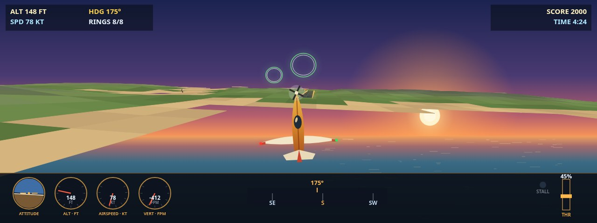

[](https://make.fun/c/best-flight-game-20261126-0057)
[](https://make.fun/c/best-flight-game-20261126-0057)
[](https://make.fun/c/best-flight-game-20261126-0057)

# Dawn Patrol over the Strait

A complete, original flight game that plays offline in a desktop browser.
Fly the little prop plane **Dawn Kestrel** out of Kestrel Field at dawn,
thread eight glowing rings over a coastal strait past a lighthouse, and land
back on the strip — with a lit cockpit instrument panel, HUD altitude /
speed / heading, synthesised engine sound, and a score against the clock.



## Play

Serve `game/` with any static server (or open it with the included one) and
fly in desktop Chrome:

```sh
node serve.ts
# open http://localhost:8080
```

No network requests, no build step, no libraries — every pixel and sound is
computed from the game's own code.

| Control | Action |
| --- | --- |
| ↑ / ↓ | Pitch up / down |
| ← / → or A / D | Bank left / right (banked turns) |
| W / S | Throttle up / down (also Shift / Ctrl, + / −) |
| Mouse | Steers like a stick when it moves |
| Enter / click | Take off |
| R | Restart |
| P | Pause |
| M | Sound on / off |

## The mission

1. Take off from Kestrel Field — full throttle, then pull up past 34 m/s.
2. Fly the eight rings in order (the next one glows gold; the HUD shows its
   distance). Each ring is **+250**.
3. Land back on the strip for a time bonus (up to +1000). Touch down gently:
   low sink rate, low speed, on the strip — or you will crash into the
   hillside or ditch in the strait.
4. Mind the stall: below 27 m/s the nose drops. Mind the terrain: the
   islands are real heightfields, not scenery.

## What is in the game

- `game/index.html` + `game/style.css` — the page shell.
- `game/src/main.js` — game loop, states, scoring, ring collection.
- `game/src/flight.js` — arcade flight model: throttle, pitch/roll, banked
  turns, lift, stall, takeoff/landing/crash detection.
- `game/src/world.js` — the strait: island heightfields, the runway valley,
  the lighthouse, the eight-ring course, clouds, boats.
- `game/src/render.js` — the scene: dawn sky and sun, glittering sea,
  shaded terrain mesh, runway lights, lighthouse beam, rings, birds.
- `game/src/plane.js` — the Dawn Kestrel, drawn with canvas paths: spinning
  prop, canopy glint, nav lights, tail strobe.
- `game/src/hud.js` — lit instruments: attitude, altimeter, airspeed,
  vertical speed, compass strip, throttle, stall lamp, plus the HUD.
- `game/src/audio.js` — synthesised WebAudio: engine drone, wind, ring
  chime, crash thud, landing fanfare. No audio files.
- `game/src/input.js` — keyboard and mouse.
- `game/src/shots.js` — deterministic screenshot scenes
  (`?shot=start|play|ring|end&seed=1`), used for the screenshots in
  `screenshots/`.

## Screenshots

| File | Scene |
| --- | --- |
| `screenshots/1-cover.jpg` | Final approach over glittering water, runway ahead |
| `screenshots/2-takeoff.jpg` | On the strip at dawn, runway and rings ahead |
| `screenshots/3-rings.jpg` | Mid-flight over the strait, next ring glowing gold |
| `screenshots/4-lighthouse.jpg` | Threading a ring past the lighthouse |

## Hand-in

`main.ts` (Node 22) copies `game/` and `screenshots/` to `$MAKEFUN_OUTPUT_DIR`
and writes `dossier.json` with the vendored `vendor/makefun-game.ts`.

Built for the [make.fun](https://make.fun) competition
[best-flight-game-20261126-0057](https://make.fun/c/best-flight-game-20261126-0057)
— "Make the best flight game". All art, sound, names and places are
original; nothing is copied from any commercial game.

## License

MIT — see [LICENSE](LICENSE).
